<div align="center">


# Open Local Dictation

**Hold a key, speak, and the text appears in the app you were using. Whisper runs on your PC; nothing leaves it.**

[Download](https://github.com/kz370/OpenLocalDictation/releases/latest) ·
[Website](https://kz370.github.io/OpenLocalDictation/) ·
[Documentation](./specs) ·
[Report an issue](https://github.com/kz370/OpenLocalDictation/issues)

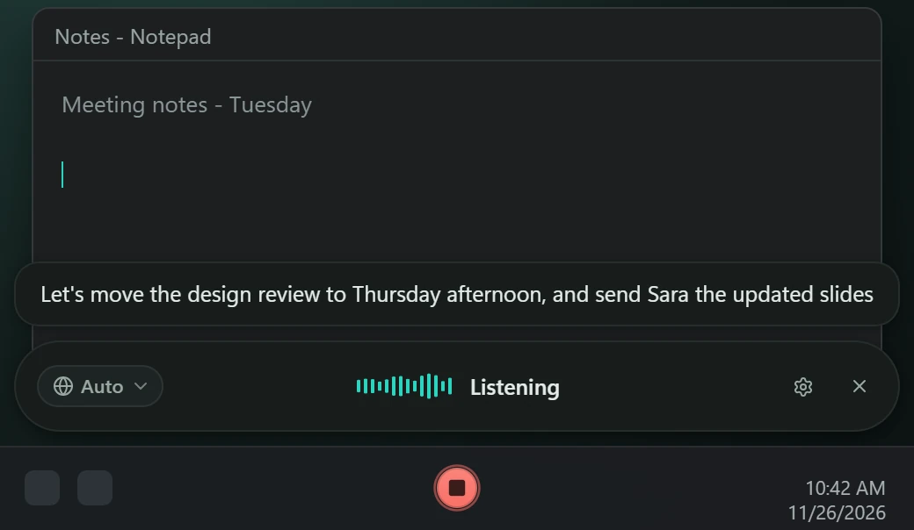

</div>

---

## What it is

Open Local Dictation is a small Windows tray app that does one thing: dictation. You hold a shortcut,
talk, and the words are typed into whatever application had the keyboard focus: Notepad, a browser, VS Code,
Word, a chat box. Speech recognition is [Whisper](https://github.com/openai/whisper) (through
[sherpa-onnx](https://github.com/k2-fsa/sherpa-onnx)), run locally on your CPU or NVIDIA GPU.

There is no account, no cloud service, no telemetry. Your voice and your text never leave the machine and are
never written to the logs.

## Contents

- [Features](#features)
- [Install](#install)
- [Using it](#using-it)
- [The pill and the taskbar button](#the-pill-and-the-taskbar-button)
- [Settings tour](#settings-tour)
- [Privacy and safety](#privacy-and-safety)
- [Troubleshooting](#troubleshooting)
- [Build from source](#build-from-source)
- [Project layout](#project-layout)
- [License](#license)

## Features

| | |
|---|---|
| **Works in any app** | Text is typed (by real key events) or pasted into the window you were in. The overlay shows which app that is and gives the focus back to it. |
| **Fully local** | Whisper *tiny*, *base* or *small* (int8) on your PC. Models are verified with SHA-256 when downloaded. |
| **About 80 languages** | Automatic detection or a chosen language, searchable, switchable from the pill while you dictate. |
| **Review before inserting** | On by default: the result opens as editable text. `Ctrl+Enter` inserts, `Ctrl+Shift+Enter` retries, `Esc` cancels. |
| **Live typing** | Turn review off and words are typed as you speak, whole words at a time. |
| **CPU or GPU** | Your choice. GPU needs an NVIDIA card and the CUDA libraries (about 1.7 GB, downloaded once, or reused from Open Local Assistant). |
| **Taskbar mic button** | An optional round button inside the Windows taskbar: click to dictate, point at it to open the pill above it. |
| **Microphone watchdog** | The tray icon and the taskbar button turn red when the microphone is unplugged, muted or blocked, and a dictation shows a warning instead of starting. |
| **Share your models** | Point the app at a folder that already holds Whisper models so other apps can use the same files. The app never deletes models. |
| **Small and quiet** | Lives in the tray, idle uses no CPU, nothing is listened to until you press the shortcut or the mic. |

## Install

Download the latest build from the [Releases page](https://github.com/kz370/OpenLocalDictation/releases/latest):

- **Setup** (`Open-Local-Dictation-<version>-setup.exe`): installs for all users into Program Files and asks for
  administrator rights.
- **Portable** (`Open-Local-Dictation-<version>-portable.zip`): unzip anywhere and run `Open Local Dictation.exe`.

Requirements: Windows 10 or 11 (64-bit), a microphone, and about 400 MB of free space for a model. A taskbar at
the bottom of the screen is needed only for the optional taskbar button.

### First run

No model is installed yet, so the Settings window opens on the **Speech model** tab. Download Whisper *tiny*,
*base* or *small* (small is the most accurate and is marked *Recommended*), or point the app at a folder that
already holds your models. Then press the shortcut in any app.

<p align="center">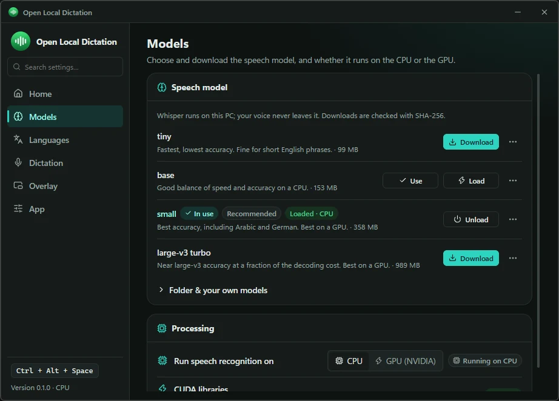</p>

## Using it

1. **Focus the app** you want to type into.
2. **Hold `Ctrl+Alt+Space`** (the default shortcut) and speak. The pill shows a live level meter and what it
   hears; a tab or label names the app the text will go into.
3. **Release the keys.** With review on, the text opens for editing; press `Ctrl+Enter` to insert it. With review
   off it is already typed.

| Action | How |
|---|---|
| Start / stop | Hold the shortcut (hold mode) or press it to start and again to stop (toggle mode). Both are in Settings > Dictation. |
| Quick tap | In hold mode, a tap shorter than 0.4 s latches recording on; the next press stops it. |
| Cancel | `Esc` anywhere, or the X on the pill. |
| Start over | **Start over** / **Retry** on the pill, or `Ctrl+Shift+Enter` in review. |
| Insert from review | `Ctrl+Enter` or the **Insert** button. |
| Copy instead | **Copy** puts the reviewed text on the clipboard. |
| Change language | The language chip on the pill (globe + code); right-click the pill for the same menu. |
| Auto-stop | A take also ends after 8 s of silence (configurable) or 5 minutes. |

<p align="center">
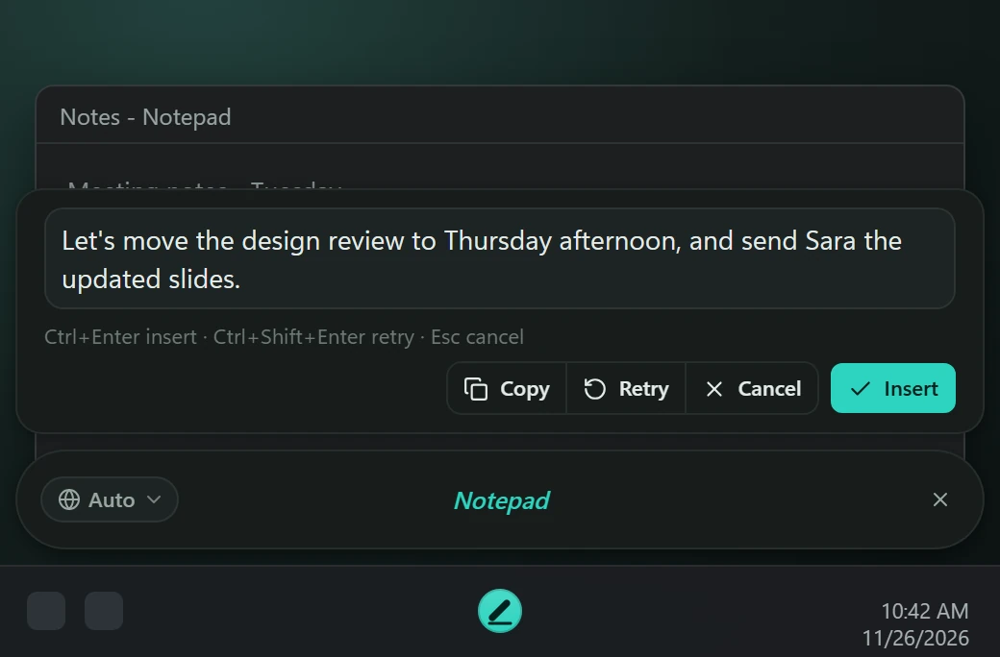
</p>

**How the text is inserted.** *Typing* (default) sends real key events by scancode using the destination window's
keyboard layout, which is exact in Notepad, browsers and most editors. *Pasting* sets the clipboard, sends
`Ctrl+V` and restores your previous clipboard text. Characters the layout cannot produce (emoji, or Arabic
under an English layout) are sent as Unicode. Add a trailing space after the text with one switch.

**Languages.** Pick *Automatic* or one of about 80 languages. Changing it mid-take restarts the take on the new
language without reloading the model. Settings > Dictation lets you choose which languages the pill's menu lists.

<p align="center">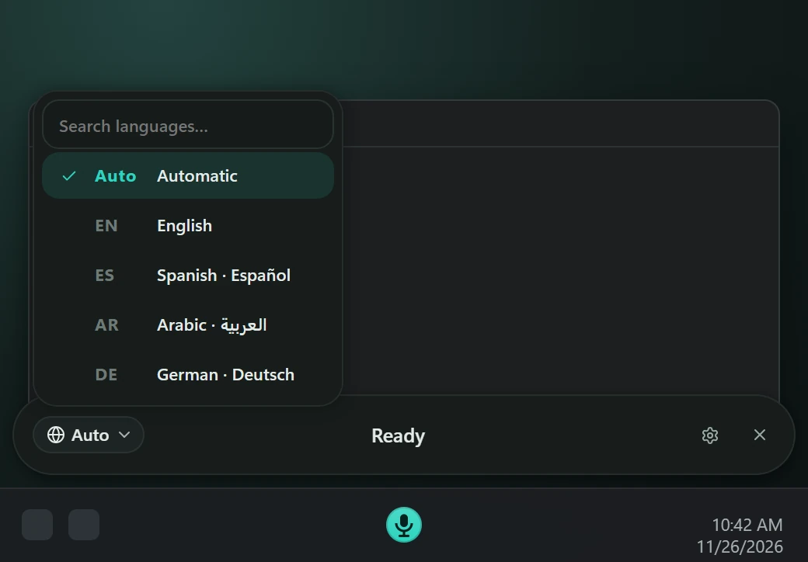</p>

## The pill and the taskbar button

The overlay is a small pill that shows the state (Ready, Listening, Transcribing, Review, Inserted), a live
spectrum, the language chip, a settings gear and a close button. What you say appears above it like a subtitle,
and the review editor opens there too. It never takes the keyboard focus while you listen, so the app you
are dictating into keeps it.

Three ways to have it:

- **Pill**: one pill with a mic inside, always on screen.
- **Bubble**: only a round mic button stays on screen; the pill opens above it when you point at it or dictate.
  Hold `Ctrl` to drag the circle on its own, drag the pill's header to move both, drag its right edge to resize
  it (it grows around its center so it never drifts from the circle).
- **Taskbar button**: the bubble's circle moved *into the Windows taskbar* (Settings > Overlay > *Mic button in
  the taskbar*). The app then draws no floating circle at all.

<p align="center">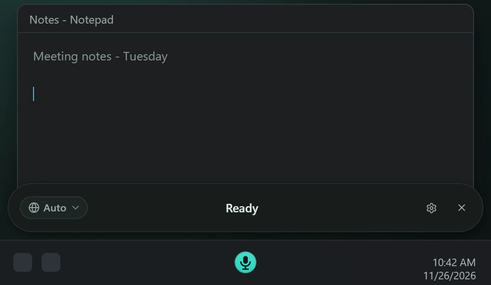</p>

### The taskbar button

- **Click** it to start dictation; click again to stop and insert.
- **Point at it** for a moment and the pill opens above it; move away and it closes.
- **Drag** it along the taskbar. It stays exactly where you put it: tray icons appearing or other widgets
  resizing never move it. *Reset position* puts it back left of the notification area.
- It shows the state: teal mic (ready), red stop square with a pulsing ring (listening), spinner (transcribing),
  pencil (review), green check (inserted), grey cross (nothing heard or cancelled), red slashed mic (no usable microphone).
- Works with a taskbar at the bottom of the screen, centered or left-aligned icons, light or dark theme, any
  scaling, and survives an Explorer restart.

<p align="center">


</p>

### Microphone watchdog

The app checks the chosen microphone (or the system default) every two seconds. If it is **unplugged or
disabled**, **muted**, or **blocked by Windows' privacy setting**, the tray icon and the idle taskbar button turn
red and the tray tooltip says what to do. Starting a dictation without a usable microphone does nothing but show
a short warning:

<p align="center">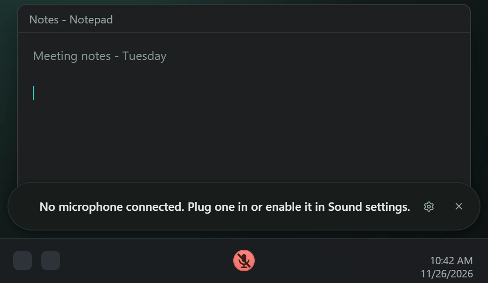</p>

## Settings tour

Open Settings from the tray icon (left click opens the idle pill; the menu has *Settings*), the gear on the pill,
or by launching the app a second time.

<table>
<tr>
<td width="50%"><b>Speech model</b><br>Download Whisper tiny, base or small, or point at a shared models folder.<br></td>
<td width="50%"><b>Processing</b><br>Run on the CPU or an NVIDIA GPU; install or reuse the CUDA libraries.<br>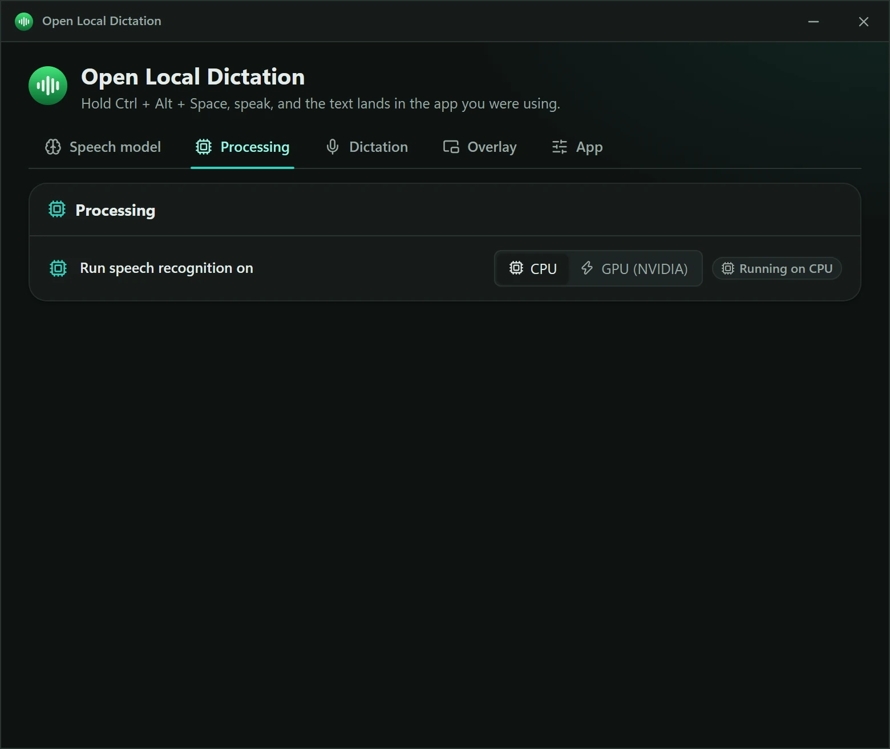</td>
</tr>
<tr>
<td><b>Dictation</b><br>Shortcut, hold or toggle, language, microphone, review, typing or pasting.<br>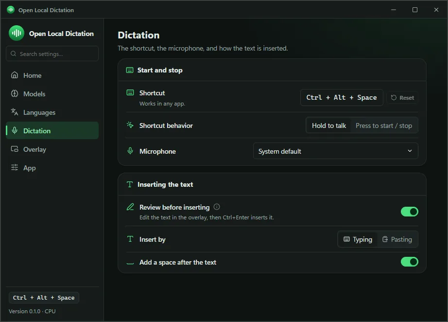</td>
<td><b>Overlay</b><br>Taskbar button, pin, size, style, opacity, position and locking.<br>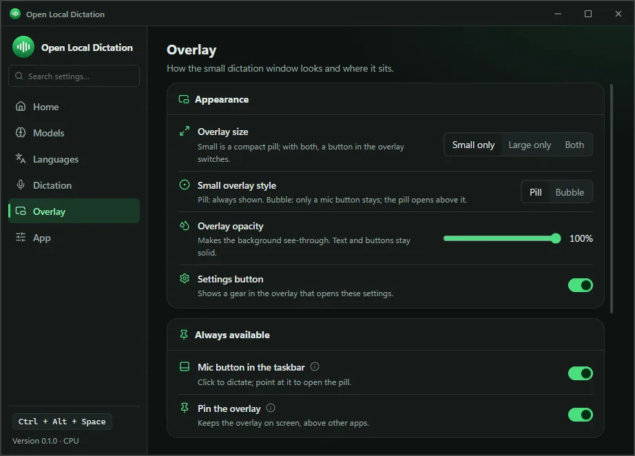</td>
</tr>
<tr>
<td><b>App</b><br>Start with Windows, theme (system, light, dark), logs.<br>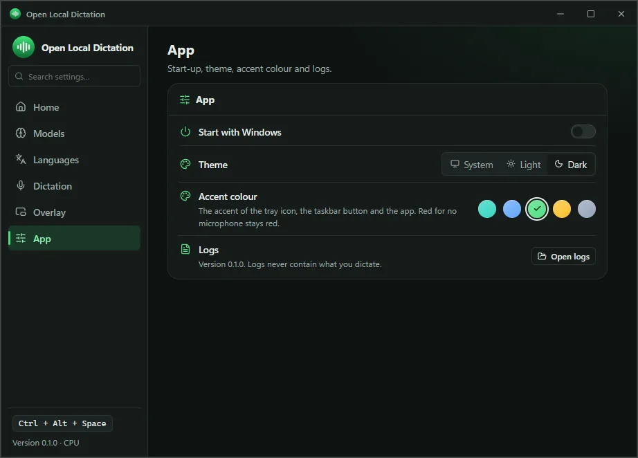</td>
<td><b>Light theme</b><br>The whole app follows the system theme or your choice.<br>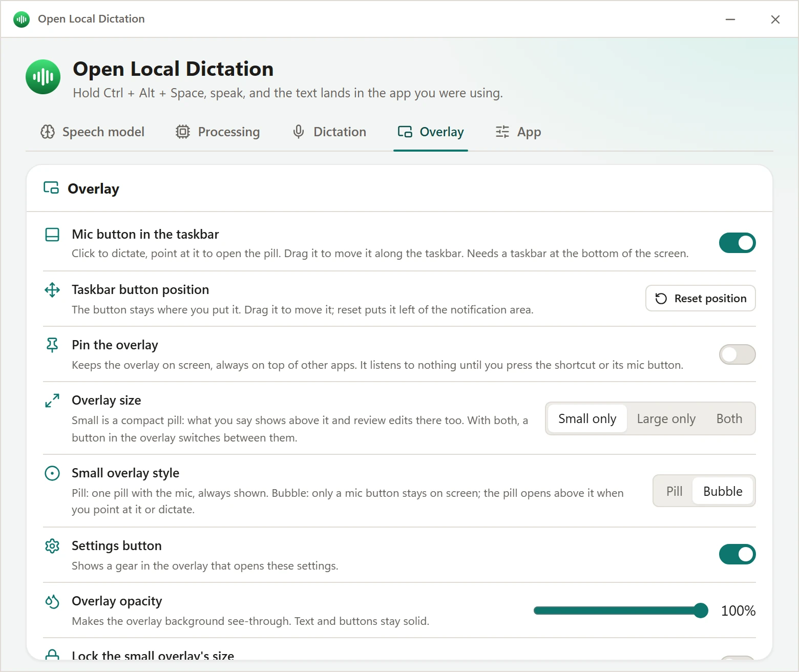</td>
</tr>
</table>

Data lives in `%APPDATA%\com.localdictation.app` (settings, models, CUDA libraries); logs are in the app's log
folder, which **Settings > App > Logs** opens.

## Privacy and safety

- Audio and dictated text **never leave the machine** and are **never written to logs**.
- Models are downloaded only after you press *Download*, from pinned sources, and verified with **SHA-256**
  before they are installed. The CUDA pack comes from pinned URLs and is checked for its required files.
- The app **never deletes models or the CUDA libraries**: there is no delete command and no delete button.
- Errors say what went wrong, why, and how to fix it.
- The taskbar button is opt-in, off by default, and does nothing but draw and forward clicks; it runs on its
  own thread so it can never stall the taskbar.

## Troubleshooting

| Symptom | Try |
|---|---|
| "No speech model is ready" | Open Settings > Speech model and download a model, or choose a models folder. |
| Red tray icon / "No microphone connected" | Plug the microphone in, or enable it in Windows Sound settings. |
| "The microphone is muted" | Unmute it in Windows Sound settings. |
| "Windows blocks the microphone" | Settings > Privacy & security > Microphone: allow access for desktop apps. |
| The shortcut does nothing | Another app may own it. Settings > Dictation shows a registration error; record a new shortcut. Modifier-only shortcuts need two or more modifiers. |
| Text lands in the wrong window | The pill names the target app; click the right window before you start. |
| No taskbar button | The taskbar must be at the bottom of the screen. Settings > Overlay shows the reason when it cannot be placed. |
| GPU is not used | Needs an NVIDIA GPU and the CUDA libraries; changing the device takes effect after a restart (the app offers *Restart now*). |

## Build from source

Needs Rust (MSVC toolchain), Node.js and, for the installer, [Inno Setup 6](https://jrsoftware.org/isinfo.php).

```text
npm install
npm run tauri dev                  # run in development
cd src-tauri && cargo fmt --all && cargo clippy --all-targets && cargo test
npm run typecheck && npm run build # frontend checks
```

Release build: `scripts\build.bat` produces the release exe, a portable folder and zip, and (with Inno Setup) a
setup file in `release\v<version>\`. Bump the version everywhere and write the release notes with
`scripts\bump-version.bat patch|minor|major|X.Y.Z` (add `-DryRun` to preview).

## Project layout

```text
src/            React UI: the overlay pill and the settings window (Vite, TypeScript)
src-tauri/      Rust backend: Tauri 2, sherpa-onnx, cpal, Win32
  src/taskbar.rs  the taskbar button (own thread, native layered child window)
  src/mic.rs      microphone watchdog
  src/stt/        speech pipeline: VAD, Whisper, sessions
specs/          architecture, behaviour, IPC API, data models, diagrams (the source of truth)
scripts/        build.bat, bump-version.bat / .ps1
website/        the project website (GitHub Pages) and its screenshots
```

Everything is described in [`specs/`](./specs): [architecture](./specs/architecture_overview.md),
[full documentation](./specs/full_documentation.md), [IPC API](./specs/api_reference.md),
[data models](./specs/data_models.txt) and the [developer guide](./specs/developer_guide.md).
[`AGENTS.md`](./AGENTS.md) explains the rule that every change updates them.

## License

GPL-3.0-only. See [LICENSE](./LICENSE).
